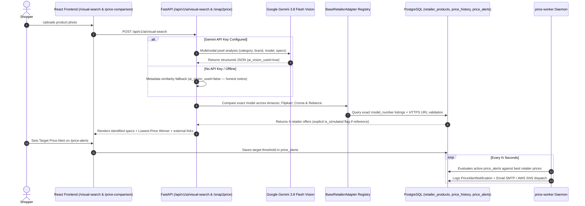
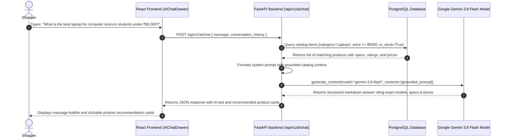
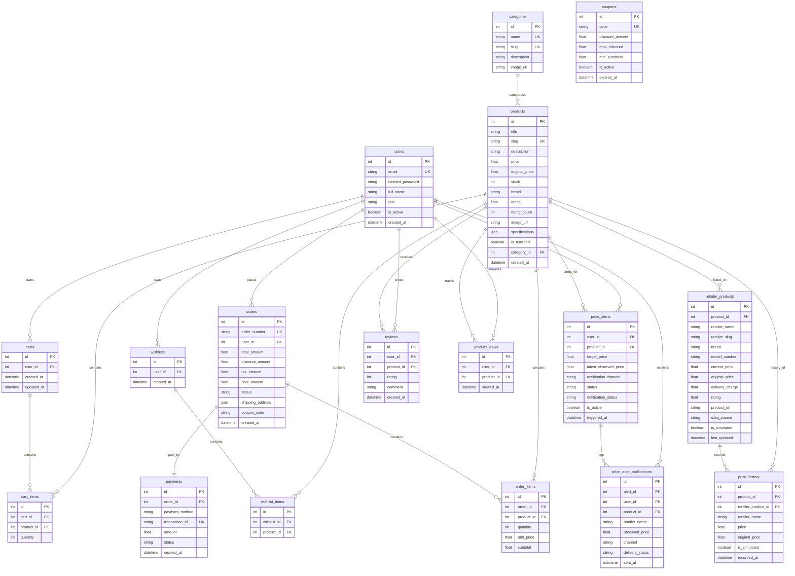
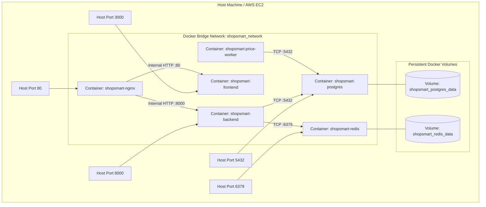
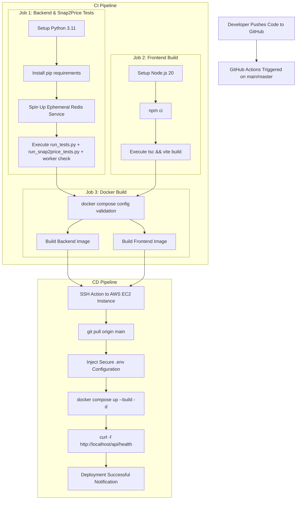

# ShopSmart AI – Detailed System Architecture & Engineering Specifications

This document provides an in-depth architectural breakdown of **ShopSmart AI**, illustrating data flows, AI inference pipelines, database relationships, and containerized deployment infrastructure.

---

## 1. High-Level Multi-Tier Architecture

```mermaid
flowchart TB
    subgraph Client Layer
        Browser[Client Web Browser / Mobile Device]
    end

    subgraph Edge & Reverse Proxy
        NginxProxy[Nginx Alpine Edge Proxy :80]
    end

    subgraph Presentation Tier
        ReactNginx[React 18 SPA on Nginx :80]
        ReactRoutes[23 Functional Pages & React Router]
        ZustandCtx[Auth, Cart, Wishlist & Toast Contexts]
    end

    subgraph Application & Worker Tier
        FastAPIServer[FastAPI Asynchronous Engine :8000]
        PriceWorker[Snap2Price Background Price Worker]
        RouterModules[11 Modular API Routers]
        PydanticSchemas[Pydantic V2 Request Validation]
        SQLAlchemyORM[SQLAlchemy 2.0 ORM Mappings]
        DirectBcrypt[Direct Bcrypt & JWT Security]
    end

    subgraph AI, ML & Adapter Intelligence
        GeminiFlash[Google Gemini 3.8 Flash SDK]
        SklearnEngine[Scikit-learn TF-IDF & Cosine Similarity]
        NLParser[Natural Language Budget & Intent Parser]
        VisionPipeline[Snap2Price Visual Identification + Fallback]
        RetailerAdapters[Amazon / Flipkart / Croma / Reliance Adapters]
        Notifier[SMTP Email / AWS SNS Dispatcher]
    end

    subgraph Storage & Persistence Tier
        PostgresDB[(PostgreSQL 16 - 17 Tables)]
        RedisStore[(Redis 7 In-Memory Cache)]
    end

    Browser -->|HTTP Requests| NginxProxy
    NginxProxy -->|Static Frontend Requests / | ReactNginx
    NginxProxy -->|REST API Requests /api/ | FastAPIServer
    ReactNginx --> ReactRoutes
    ReactRoutes --> ZustandCtx

    FastAPIServer --> RouterModules
    RouterModules --> PydanticSchemas
    RouterModules --> SQLAlchemyORM
    RouterModules --> DirectBcrypt

    RouterModules -->|AI Queries & Prompts| GeminiFlash
    RouterModules -->|Catalog Embeddings & Recs| SklearnEngine
    RouterModules --> NLParser
    RouterModules --> VisionPipeline
    RouterModules --> RetailerAdapters
    PriceWorker --> RetailerAdapters
    PriceWorker --> Notifier

    SQLAlchemyORM -->|Persistent Storage| PostgresDB
    PriceWorker -->|Monitor & Notify| PostgresDB
    FastAPIServer -->|Session & Query Caching| RedisStore
```

---

## 2. Snap2Price Visual Identification -> Comparison & Alert Sequence



---

## 2. Google Gemini 3.8 Flash Grounded AI Chat Sequence

The conversational shopping concierge utilizes **Retrieval-Augmented Grounding** to prevent factual hallucination:



---

## 3. Scikit-learn Content-Based Recommendation Pipeline

The recommendation engine translates text metadata into mathematical vectors to calculate cosine similarity:

```mermaid
flowchart LR
    subgraph Data Preparation
        P1[Title & Brand] --> Concat[Text Corpus Concatenation]
        P2[Category] --> Concat
        P3[Description & Specs] --> Concat
    end

    subgraph Vectorization
        Concat --> TFIDF[Scikit-Learn TfidfVectorizer]
        TFIDF -->|max_features=5000, ngram=(1,2)| Matrix[TF-IDF Feature Matrix]
    end

    subgraph Similarity Matrix
        Matrix --> Cosine[Cosine Similarity Calculation]
        Cosine --> SimScores[N x N Similarity Score Matrix]
    end

    subgraph Recommendation Inference
        QueryItem[Target Product ID] --> Lookup[Lookup Top K Scores]
        SimScores --> Lookup
        Lookup --> Rank[Rank & Filter In-Stock]
        Rank --> Output[Top Similar Product Recommendations]
    end
```

---

## 4. Database Entity-Relationship Diagram (17 Relational Tables)



---

## 5. Docker Container Network & Volume Topology (6 Services)

All six application services are isolated inside an internal Docker bridge network (`shopsmart_network`):



---

## 6. Continuous Integration & Deployment (CI/CD) Workflow


