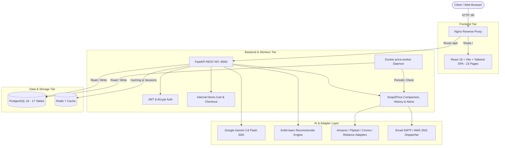
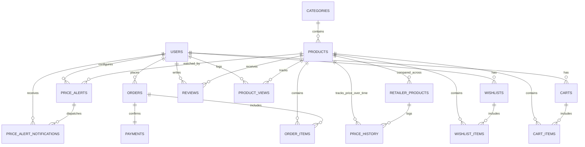

# ShopSmart AI + Snap2Price – AI-Powered Visual Shopping & Multi-Retailer Price Intelligence Platform

[](https://github.com/your-username/shopsmart-ai/actions)
[](https://fastapi.tiangolo.com)
[](https://react.dev)
[](https://www.typescriptlang.org)
[](https://vitejs.dev)
[](https://tailwindcss.com)
[](https://aistudio.google.com)
[](https://scikit-learn.org)
[](https://www.docker.com)
[](https://www.postgresql.org)
[](https://redis.io)
[](https://www.terraform.io)

---

## 📌 Executive Summary & Abstract

**ShopSmart AI (with Snap2Price Enhancement)** is a production-grade, full-stack, AI-driven e-commerce and price-intelligence platform engineered as a final-year academic and DevOps capstone project. Combining **ShopSmart AI**'s complete e-commerce platform with the **Snap2Price** visual shopping & price-tracking suite, it pairs **Generative Multimodal AI** (*Google Gemini 3.8 Flash*) and **Classical Machine Learning** (*Scikit-learn Content-Based Filtering*) with cloud-native DevOps automation.

### Key Capabilities:
- **Snap2Price Multi-Platform Price Comparison (`/price-comparison`)**: Compare identical models & verified specifications across **Amazon India, Flipkart, Croma, and Reliance Digital**, ranked by total landed cost (item price + delivery), with lowest-price recommendations and verified HTTPS merchant URLs. Supports adapter architecture (`BaseRetailerAdapter`) separating live affiliate feeds from clearly labelled academic mock feeds.
- **Snap2Price Price History Tracking (`/price-history/:productId`)**: Persist timestamped price snapshots (`price_history`) and visualize 30-day multi-retailer price curves via Recharts with min/max/latest benchmarks and downward/rising trend alerts.
- **Snap2Price Automated Price-Drop Alerts (`/price-alerts`)**: Set custom target prices (`price_alerts`) monitored continuously by a background Docker worker (`price-worker`), dispatching notifications via Email SMTP, AWS SNS, or transparent academic delivery logs (`price_alert_notifications`).
- **Enhanced AI Visual Product Identification (`/visual-search`)**: Upload a product image for Google Gemini multimodal identification (category, brand, exact model, visual attributes, specs) connected directly into the multi-retailer price comparison flow — with strict transparency reporting whenever metadata similarity fallback is active instead of vision understanding.
- **Intelligent Shopping Concierge & Natural Language Search**: Grounded conversational assistant (`gemini-3.8-flash`), natural-language budget query parsing, Scikit-learn TF-IDF recommendation matrix, full 23-page storefront/admin UI, and simulated academic checkout.

---

## 🏗️ System Architecture



---

## 💻 Technology Stack

| Layer | Technologies Used | Description |
| :--- | :--- | :--- |
| **Frontend** | React 18, TypeScript, Vite 5, Tailwind CSS, Framer Motion, Lucide Icons, Recharts | High-performance Single Page Application (SPA) with responsive mobile/desktop UI and dark navy/purple accents. |
| **Backend** | Python 3.11, FastAPI, SQLAlchemy 2.0, Pydantic V2, Uvicorn | High-throughput asynchronous RESTful API with automated OpenAPI / Swagger documentation. |
| **Authentication** | JWT (JSON Web Tokens), Bcrypt Password Hashing, HTTP Bearer | Secure stateless authentication with role-based access control (Admin & Customer). |
| **AI / GenAI** | Google Gemini 3.8 Flash (`google-genai` SDK) | Multimodal image understanding, natural language chat, spec comparison, and review synthesis. |
| **Machine Learning** | Scikit-learn, NumPy | Content-based recommendation matrix using TF-IDF vectorization and cosine similarity calculations. |
| **Database** | PostgreSQL 16 (Relational DB) | ACID-compliant storage with 17 relational tables (including `retailer_products`, `price_history`, `price_alerts`, `price_alert_notifications`), indexes, and foreign key cascades. |
| **Caching & Workers** | Redis 7, Dedicated Python Price Monitor Worker | Sub-millisecond catalog caching and automated background worker (`price-worker`) checking target price thresholds. |
| **DevOps & Containers** | Docker, Docker Compose (6 Services), Multi-stage builds | Production containerization isolating frontend, backend, `price-worker`, PostgreSQL, Redis, and Nginx. |
| **Reverse Proxy** | Nginx Alpine | Edge proxy handling SSL termination, static gzip compression, and `/api/` routing. |
| **CI/CD** | GitHub Actions | Automated linting, 20 core + Snap2Price pytest suites, Vite production builds, Docker image building, and SSH deployment. |
| **Infrastructure as Code** | Terraform, AWS EC2, VPC, Subnets, Security Groups | Declarative provisioning of AWS cloud infrastructure with automated `user_data.sh` setup. |

---

## 🗄️ Database Architecture (17 Relational Tables)



### Table Dictionary:
1. **`users`**: Customer and administrator profiles, email, hashed passwords, roles.
2. **`categories`**: Taxonomy hierarchy (Electronics, Laptops, Audio, Wearables, etc.).
3. **`products`**: Catalog details, prices in INR (`₹`), stock counts, SKU, ratings, specs, image URLs.
4. **`carts`**: Active shopping carts per registered or guest user.
5. **`cart_items`**: Line items, quantities, and price snapshots.
6. **`wishlists`**: Saved collections per user.
7. **`wishlist_items`**: Products bookmarked for future consideration.
8. **`orders`**: Placed transactions, total amounts, discount codes, shipping addresses, statuses.
9. **`order_items`**: Historical record of products, quantities, and unit prices purchased.
10. **`payments`**: Simulated payment transaction logs (`SUCCESS` / `FAILED`), transaction IDs, payment methods.
11. **`reviews`**: Customer ratings (1-5 stars) and qualitative feedback.
12. **`product_views`**: User interaction log powering personalized recommendations.
13. **`coupons`**: Discount engine (`SMART10`, `WELCOME15`, `SUPER20`, `COLLEGE500`) with thresholds and expiry.
14. **`retailer_products`** *(Snap2Price)*: Exact-model multi-retailer listings (Amazon India, Flipkart, Croma, Reliance Digital) with delivery fees, discount percentages, verified URLs, `is_simulated` reference flags, and `data_source` tags.
15. **`price_history`** *(Snap2Price)*: Timestamped price observations per retailer storing historical lows, highs, averages, and chart trend series.
16. **`price_alerts`** *(Snap2Price)*: User target price thresholds (`active`, `triggered`, `paused`), notification channels (`email`, `aws_sns`, `in_app`), and check timestamps.
17. **`price_alert_notifications`** *(Snap2Price)*: Audit log of dispatched notifications, delivery statuses (`sent_smtp`, `sent_aws_sns`, `simulated_delivered`), and direct merchant links.

---

## 🤖 AI, Machine Learning & Snap2Price Intelligence

### 1. Google Gemini 3.8 Flash Multimodal Integration
- **Visual Product Identification (`/api/v1/ai/visual-search`)**: Analyzes uploaded images via Google Gemini Vision to identify category, brand, exact model, product name, visual attributes, and relevant specs—feeding directly into multi-retailer price comparison. *Strict Honesty Rule*: If no Gemini API key is configured or binary pixel understanding did not execute, the API explicitly flags `ai_vision_used: false` (`metadata_similarity_fallback`) and never claims image understanding occurred.
- **Conversational Concierge (`/api/v1/ai/chat`)**: Utilizes `gemini-3.8-flash` grounded with live catalog context to prevent factual hallucinations.
- **Smart Query Interpretation (`/api/v1/ai/smart-search`)**: Converts free-form human queries into structured budget, category, brand, and rating filters.
- **Review Sentiment & Pros/Cons Synthesis (`/api/v1/reviews/{id}/summary`)**: Summarizes customer reviews into executive takeaways, top pros, and cons.

### 2. Snap2Price Retailer Adapter & Price Monitoring Pipeline
- **Retailer Adapter Architecture (`BaseRetailerAdapter`)**: Modular adapters (`AmazonIndiaAdapter`, `FlipkartAdapter`, `CromaAdapter`, `RelianceDigitalAdapter`) allow drop-in connection to live partner affiliate APIs while providing clearly labelled `Simulated Reference Feed (Academic Demo)` pricing whenever external credentials are absent.
- **Exact Model Matching & URL Validation**: Matches canonical `model_number` and specifications (`RAM`, `Storage`, `Processor`, `Display`) before comparing landed cost (`current_price + delivery_charge`). Validates outbound HTTPS URLs against trusted retailer hostnames.
- **Background Price Worker (`app.workers.price_monitor`)**: Periodically evaluates active `price_alerts`, records price snapshots, detects drops at or below target thresholds, and delivers notifications via SMTP Email, AWS SNS, or recorded simulated delivery logs.

### 3. Scikit-learn Content-Based Recommender
- **TF-IDF Vectorization & Cosine Similarity Matrix**: Computes angular similarity between product text vectors for real-time similar item discovery and personalized browsing feeds.

---

## 🖥️ Frontend Storefront & 23 Functional Pages

The UI features a light slate background, dark navy typography, purple/indigo AI accents, and emerald Snap2Price best-deal highlights:

1. **Home Page (`/`)**: Hero banner, smart search, featured products, Snap2Price shortcuts, categories, trending carousel.
2. **Login Page (`/login`)**: JWT login with quick demo buttons for Admin & Demo Customer.
3. **Registration Page (`/register`)**: New customer account registration.
4. **Product Listing Page (`/products`)**: Category, brand, price slider, sorting, and natural-language AI search.
5. **Product Details Page (`/products/:id`)**: Specs, reviews, ShopSmart Demo Cart actions, and Snap2Price Multi-Retailer / History bar.
6. **AI Visual Search Page (`/visual-search`)**: Upload photo / demo presets -> Gemini Vision identification -> direct 4-retailer Snap2Price comparison panel & catalog hits.
7. **Multi-Platform Price Comparison (`/price-comparison`)** *(New)*: Exact-model comparison across Amazon India, Flipkart, Croma & Reliance Digital with lowest landed-price winner, verified outbound merchant links, and quick alerts.
8. **Price History Tracker (`/price-history/:productId`)** *(New)*: Interactive Recharts multi-retailer timeline, min/max/latest cards, trend indicator, and instant observation logging.
9. **Price Drop Alerts Dashboard (`/price-alerts`)** *(New)*: Configure target prices, pick Email / AWS SNS / In-App notifications, trigger background checks or simulated price drops, and inspect notification delivery history.
10. **AI Recommendations Page (`/recommendations`)**: Personalized discovery feed.
11. **Product Comparison Page (`/compare`)**: Side-by-side internal catalog spec comparison with AI buyer verdict.
12. **Shopping Cart Page (`/cart`)**: ShopSmart internal demo cart, coupon codes, tax calculation.
13. **Checkout Page (`/checkout`)**: Simulated academic checkout gateway with success/failure toggle.
14. **Order Confirmation Page (`/order-confirmation/:orderNumber`)**: Simulated order receipt and timeline.
15. **My Orders Page (`/orders`)**: Customer order history and status tracking.
16. **Wishlist Page (`/wishlist`)**: Saved favorites management.
17. **User Profile Page (`/profile`)**: Account profile & role view.
18. **AI Shopping Assistant Page (`/assistant`)**: Full-screen conversational concierge.
19. **Admin Dashboard (`/admin`)**: Business metrics, recent orders, low-stock warnings.
20. **Admin Product Management (`/admin/products`)**: Catalog CRUD and inventory control.
21. **Admin Order Management (`/admin/orders`)**: Customer order status management.
22. **Admin User Management (`/admin/users`)**: Customer directory.
23. **Admin Analytics Dashboard (`/admin/analytics`)**: Interactive Recharts sales and category analytics.

---

## 🚀 Quick Start Guide (Local Execution)

### Option A: Run with Docker Compose (Recommended)

1. **Clone the repository**:
   ```bash
   git clone https://github.com/your-username/shopsmart-ai.git
   cd shopsmart-ai
   ```

2. **Configure environment variables**:
   ```bash
   cp .env.example .env
   # Edit .env and paste your GEMINI_API_KEY from https://aistudio.google.com/app/apikey
   ```

3. **Start all 5 services with Docker Compose**:
   ```bash
   docker compose up --build -d
   ```

4. **Access the application**:
   - 🌐 **Storefront**: [http://localhost](http://localhost)
   - 📚 **Swagger API Docs**: [http://localhost/docs](http://localhost/docs)
   - 🩺 **Backend Health**: [http://localhost/api/health](http://localhost/api/health)

---

### Option B: Run Manually (Without Docker)

#### 1. Backend Setup:
```bash
cd backend
python -m venv venv
# On Windows:
.\venv\Scripts\activate
# On Linux/macOS:
source venv/bin/activate

pip install -r requirements.txt

# Start backend server (SQLite database & 48 seed products created automatically)
uvicorn app.main:app --reload --port 8000
```

#### 2. Frontend Setup:
```bash
cd frontend
npm install
npm run dev
# Access frontend at http://localhost:3000
```

---

## 🔑 Default Academic Demo Credentials

| Role | Email Address | Password | Permissions |
| :--- | :--- | :--- | :--- |
| **Administrator** | `admin@shopsmart.ai` | `Admin@123` | Full access to Admin Dashboard, Analytics, Inventory Management, Order Updating, and User Directory. |
| **Demo Customer** | `demo@shopsmart.ai` | `Demo@123` | Storefront browsing, AI Assistant, Visual Search, Cart, Wishlist, Checkout, and Order History. |

> **Note**: You can also register a brand-new customer account directly through the `/register` page at any time.

---

## 💳 Simulated Payment Gateway (Academic Demonstration)

> [!NOTE]
> This application incorporates a **simulated payment gateway** strictly designed for academic demonstration and faculty evaluation. **No real financial transactions or credit card charges take place.**

The simulated gateway supports:
- **Success Scenarios**: Simulates payment authorization, generates unique mock transaction reference IDs (`TXN-MOCK-...`), updates order status to `PROCESSING`, and sends the user to Order Confirmation.
- **Failure Scenarios**: Toggle the "Simulate Payment Failure" switch on the checkout screen to demonstrate robust error handling, transactional rollbacks, and descriptive user notifications.

---

## ⚙️ DevOps & Cloud Deployment (AWS & Terraform)

### Terraform Infrastructure Provisioning
The `terraform/` directory contains complete Infrastructure-as-Code definitions:
- **VPC & Subnet**: Dedicated CIDR `10.0.0.0/16` with public subnet `10.0.1.0/24`.
- **Security Group**: Allows inbound traffic on ports `80` (HTTP), `443` (HTTPS), `8000` (FastAPI), and `22` (SSH).
- **EC2 Instance**: Ubuntu 22.04 LTS (`t3.small` or `t2.micro` Free-Tier eligible) with 30GB gp3 EBS storage.
- **Elastic IP (EIP)**: Fixed public IP for persistent demonstration.
- **Automated Cloud-Init (`user_data.sh`)**: Automatically installs Docker, Docker Compose, Git, UFW firewall, and configures systemd auto-restart services upon first boot.

```bash
cd terraform
cp terraform.tfvars.example terraform.tfvars
terraform init
terraform plan
# Execute only with explicit user authorization:
terraform apply
```

### GitHub Actions CI/CD Pipeline (`.github/workflows/ci-cd.yml`)
1. **Lint & Test**: Installs Python 3.11, spins up temporary Redis container, runs `run_tests.py` (20 core suites), `run_snap2price_tests.py` (8 Snap2Price suites), and tests `app.workers.price_monitor --once`.
2. **Frontend Typecheck & Build**: Executes `tsc && vite build` ensuring production assets compile with zero errors.
3. **Docker Build & Verification**: Validates `docker-compose.yml` syntax and builds Docker images using Buildx cache.
4. **Automated EC2 Deployment**: Connects via SSH to AWS EC2, pulls `main` branch, and restarts containers with zero downtime.

---

## 🧪 Testing and Verification Results

### 1. Core ShopSmart AI Backend Tests (`backend/run_tests.py` — 20/20 Passed)
- Categories, 48-product catalog filtering, Customer & Admin JWT Auth, TF-IDF Recommendations, Shopping Cart, Coupon engine (`SMART10`), Wishlist, Simulated Checkout & Failure handling, Smart Search NLP, Gemini Chat Concierge, Visual Search fallback honesty, Product Comparison, Review Sentiment Synthesis, Admin Analytics.

### 2. Snap2Price Enhancement Tests (`backend/run_snap2price_tests.py` & `pytest tests/` — 25/25 Pytest Passed)
- Exact model matching & canonical SKU verification across Amazon India, Flipkart, Croma & Reliance Digital
- Lowest total landed-price selection (including delivery fee calculation)
- Strict HTTPS retailer URL domain validation & unsafe scheme blocking
- Timestamped `price_history` observation storage, min/max/latest metrics & trend calculation
- Customer `price_alerts` creation, background price-drop detection & notification dispatch logging (`simulated_delivered` / `sent_smtp` / `sent_aws_sns`)
- Honest Visual Identification distinction (`gemini_multimodal_vision` vs `metadata_similarity_fallback`) wired directly into 4-retailer comparison

Frontend production build (`tsc && vite build`) executes in **7.54s** with zero compilation warnings:
```
dist/index.html                   1.20 kB │ gzip:   0.68 kB
dist/assets/index-BDC9kcgn.css   51.23 kB │ gzip:   8.52 kB
dist/assets/index-DsM9-Ml0.js   891.10 kB │ gzip: 238.41 kB
✓ built in 7.54s
```

---

## 🔐 Features Requiring External Credentials (Graceful Academic Fallbacks Built-In)

| Feature | Required Credentials in `.env` | Built-in Fallback When Unconfigured |
| :--- | :--- | :--- |
| **Gemini Multimodal Vision & Chat** | `GEMINI_API_KEY` | Explicitly switches visual identification to `metadata_similarity_fallback` (never claims image understanding) & uses grounded rule responses. |
| **Live Retailer Affiliate Feeds** | `AMAZON_PA_API_KEY`, `FLIPKART_AFFILIATE_ID`, `FLIPKART_AFFILIATE_TOKEN`, `CROMA_API_KEY`, `RELIANCE_API_KEY` | Serves clearly labelled `Reference Simulated Retailer Feed (Academic Demo)` data (`is_simulated=True`) across adapters. |
| **Live Email Dispatch** | `SMTP_HOST`, `SMTP_USER`, `SMTP_PASSWORD` | Logs delivery transparently in `price_alert_notifications` with `delivery_status="simulated_delivered"`. |
| **Live AWS SNS Alerts** | `AWS_SNS_TOPIC_ARN`, AWS IAM/Keys (`boto3`) | Falls back transparently to simulated in-app notification logs. |

---

## 📁 Project Folder Structure

```
shopsmart-ai/
├── .github/
│   └── workflows/
│       └── ci-cd.yml             # GitHub Actions CI/CD Pipeline
├── backend/
│   ├── app/
│   │   ├── ai/                   # Gemini Vision, NLP Search, Recommender, Visual Search
│   │   ├── api/                  # 11 FastAPI Router Modules (+ snap2price.py)
│   │   ├── models/               # 17 SQLAlchemy ORM Models (+ snap2price.py)
│   │   ├── schemas/              # Pydantic V2 Request/Response Schemas (+ snap2price.py)
│   │   ├── seed/                 # 48-Product Catalog + 192 Retailer Offers + History Seed
│   │   ├── services/             # Retailer Adapters, URL Validator, Price Alert Engine
│   │   ├── utils/                # Auth, JWT, Redis Client
│   │   ├── workers/              # Background Price Monitor Worker Daemon (price_monitor.py)
│   │   ├── config.py             # Environment & Optional External Integration Settings
│   │   ├── database.py           # Database Engine & Sessionmaker
│   │   └── main.py               # FastAPI App & Router Registration
│   ├── tests/                    # Automated Pytest Suites (test_snap2price.py + core suites)
│   ├── Dockerfile                # Backend & Worker Docker Configuration
│   ├── requirements.txt          # Python Dependencies
│   ├── run_tests.py              # 20-Suite Core Test Runner
│   └── run_snap2price_tests.py   # Snap2Price Verification Suite
├── frontend/
│   ├── src/
│   │   ├── components/           # UI Components (Navbar, Footer, ProductCard, AIChatDrawer, etc.)
│   │   ├── context/              # React Contexts (Auth, Cart, Wishlist, Toast)
│   │   ├── pages/                # 23 Functional Pages (15 Storefront + 3 Snap2Price + 5 Admin)
│   │   │   └── admin/            # 5 Admin Pages (Dashboard, Products, Orders, Users, Analytics)
│   │   ├── services/             # Axios API Client & Endpoints
│   │   ├── types/                # TypeScript Interfaces & Types
│   │   ├── App.tsx               # Route Definitions & Root Layout
│   │   ├── index.css             # Tailwind Directives & Custom Fonts
│   │   └── main.tsx              # DOM Mounting Entrypoint
│   ├── Dockerfile                # Multi-stage Frontend Dockerfile
│   ├── nginx.conf                # Frontend SPA Nginx Configuration
│   ├── package.json              # Frontend Dependencies & Scripts
│   ├── tailwind.config.js        # Custom Theme Colors & Typography
│   └── vite.config.ts            # Vite Bundler & Dev Proxy
├── nginx/
│   └── default.conf              # Reverse Proxy Nginx Configuration
├── terraform/
│   ├── main.tf                   # AWS VPC, Subnet, SG, EC2 & EIP Definitions
│   ├── variables.tf              # Configurable Infrastructure Variables
│   ├── outputs.tf                # Provisioned IP & URL Outputs
│   ├── terraform.tfvars.example  # Example Variable Values
│   ├── user_data.sh              # EC2 Cloud-Init Automation Script
│   └── deploy.sh                 # Production Deployment & Healthcheck Script
├── .dockerignore
├── .env.example                  # Environment Variables Template
├── docker-compose.yml            # 6-Service Compose Definition (+ price-worker)
├── README.md                     # Comprehensive Project Overview
├── PROJECT_REPORT.md             # Formal Academic Capstone Report
├── ARCHITECTURE.md               # In-Depth System Architecture & Diagrams
├── API_DOCUMENTATION.md          # REST API Specification & Examples
└── DEMO_GUIDE.md                 # Viva Voce & Presentation Script
```

---

## 📜 Academic Viva Voce / Project Presentation Guide

For your college evaluation:
1. Review the step-by-step walkthrough in [`DEMO_GUIDE.md`](./DEMO_GUIDE.md).
2. Review the formal IEEE-style capstone project report in [`PROJECT_REPORT.md`](./PROJECT_REPORT.md).
3. Review the complete endpoint reference in [`API_DOCUMENTATION.md`](./API_DOCUMENTATION.md).
4. Review the detailed data flow and architectural models in [`ARCHITECTURE.md`](./ARCHITECTURE.md).

---

## 📄 License & Attribution

This project is submitted for academic evaluation in partial fulfillment of the requirements for the degree of Bachelor of Technology / Computer Science & Engineering. Developed with ❤️ using Google Gemini API and modern open-source technologies.
